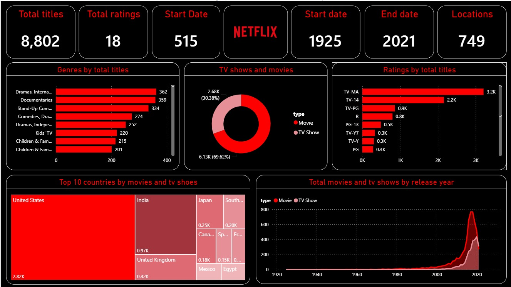

# Netflix Content Analysis Dashboard | Power BI

## Project Overview

An interactive Power BI dashboard built to explore and analyse Netflix's content catalogue. The project focuses on understanding content distribution, genres, ratings, countries and release-year trends through data visualisation.

## Dashboard Preview

## Key Metrics

- **Total Titles:** 8,802
- **Content Types:** Movies and TV Shows
- **Countries:** 749

## Key Analysis

- Movies vs TV Shows distribution
- Content ratings across the catalogue
- Popular genres and categories
- Country-wise content distribution
- Content trends by release year
- Key catalogue metrics through KPI cards

## Tools Used

- Microsoft Power BI
- CSV Dataset
- Data Analysis
- Data Visualisation

## Dataset

Source: [Netflix Movies and TV Shows Dataset – Kaggle](https://www.kaggle.com/datasets/shivamb/netflix-shows)

## Project Files

- `Netflix_Content_Analysis.pbix` – Power BI dashboard file
- `netflix_titles.csv` – Dataset used for analysis
- `Netflix_Dashboard.jpeg` – Dashboard preview

## Objective

To practise business intelligence and data visualisation by transforming a content dataset into an interactive dashboard that makes key patterns and trends easier to understand.

---

**Created using Microsoft Power BI.**
